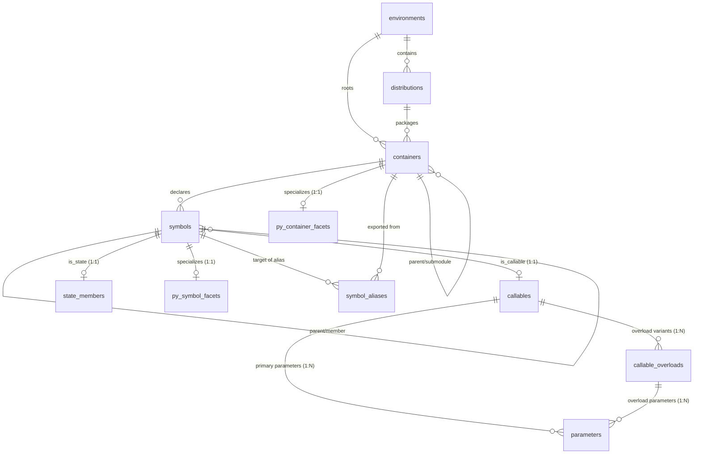

# UTSS Relational Database Schema Specification

**Version:** 0.2.0 (Phase 2 Typeshed Overlay)  
**Storage Engine:** SQLite 3 (WAL Mode, Foreign Keys Enforced)  
**Database File:** Typically `catalog.db` or user-specified path  

> [!NOTE]
> This document details the specific DDL definitions for the Python harvester. For the centralized schema matrix and DDL across all 6 languages (Python, C#, Rust, TypeScript, C++, Go) plus the Universal Bridge DDL, see [schemas/README.md](../schemas/README.md).  

---

## 1. Architectural Philosophy: The Dual-Layer Schema

Compilers and multi-language transpilers (such as the Python-to-C# transpiler `psc`) require a symbol database that achieves two contradictory goals simultaneously:
1. **Universal Portability (Layer 1 - Universal Core)**: The core schema must model software structures using universal compiler Intermediate Representation (IR) concepts—Environments, Modules/Namespaces, Symbols, Callables, Parameters, State Members, and Aliases—agnostic to any single source language.
2. **Language-Specific Fidelity (Layer 2 - Python Facets)**: Real languages have esoteric runtime mechanics. Python has C-extension modules vs. frozen modules, MRO linearization, property/descriptor protocols, dunders (`__getitem__`, `__enter__`), and dynamic `__all__` re-exports. Stripping these breaks Python semantics; putting them in the universal tables breaks language portability.

**UTSS resolves this by splitting the schema into a Dual-Layer design:**
- **Tables 1–9: Universal Core**: Strict, relational, language-agnostic compiler symbol tables.
- **Tables 10–11: Python-Fidelity Facets**: Attached to Core entities via strict `1:1` foreign keys with `ON DELETE CASCADE`.

---

## 2. Entity Relationship Diagram (ERD)



---

## 3. SQLite Pragmas & Operational Settings

Every connection to the UTSS database must initialize with the following SQLite pragmas:

```sql
PRAGMA foreign_keys = ON;
PRAGMA journal_mode = WAL;
PRAGMA synchronous = NORMAL;
```

- **`foreign_keys = ON`**: Enforces relational integrity across all 11 tables and executes `ON DELETE CASCADE` actions.
- **`journal_mode = WAL`**: Write-Ahead Logging allows concurrent readers alongside active harvesters without database locks.
- **`synchronous = NORMAL`**: Maximizes bulk insert throughput during large standard library and workspace harvests while guaranteeing data durability.

---

## 4. Layer 1: Universal Core Tables (1–9)

### 4.1 Table: `environments`
Captures the execution environment, operating system, and language interpreter host.

```sql
CREATE TABLE environments (
    env_id INTEGER PRIMARY KEY AUTOINCREMENT,
    runtime_name TEXT NOT NULL,       -- e.g. 'cpython', 'pypy', 'dotnet'
    runtime_version TEXT NOT NULL,    -- e.g. '3.13.12'
    architecture TEXT NOT NULL,       -- e.g. 'x86_64', 'arm64'
    os_name TEXT NOT NULL,            -- e.g. 'Linux', 'Darwin', 'Windows'
    sys_platform TEXT NOT NULL,       -- e.g. 'linux', 'darwin', 'win32'
    executable_path TEXT NOT NULL,    -- Path to python interpreter
    created_at TIMESTAMP DEFAULT CURRENT_TIMESTAMP
);
```

| Column | Type | Nullable | Description |
| :--- | :--- | :---: | :--- |
| `env_id` | `INTEGER` | No | Auto-incrementing primary key. |
| `runtime_name` | `TEXT` | No | Identifier for the runtime engine (e.g. `'cpython'`). |
| `runtime_version` | `TEXT` | No | Full semantic version of the interpreter (e.g. `'3.13.12'`). |
| `architecture` | `TEXT` | No | Hardware architecture from `platform.machine()` (`'x86_64'`). |
| `os_name` | `TEXT` | No | Operating system name from `platform.system()` (`'Linux'`). |
| `sys_platform` | `TEXT` | No | Normalized `sys.platform` string used for Typeshed guard evaluation (`'linux'`, `'win32'`, `'darwin'`). |
| `executable_path` | `TEXT` | No | Absolute path to the active interpreter (`sys.executable`). |
| `created_at` | `TIMESTAMP`| No | Timestamp when the environment record was created. |

---

### 4.2 Table: `distributions`
Represents an installable package or distribution boundary (e.g., standard library bundle, pip wheel, NuGet package).

```sql
CREATE TABLE distributions (
    distribution_id INTEGER PRIMARY KEY AUTOINCREMENT,
    env_id INTEGER NOT NULL REFERENCES environments(env_id) ON DELETE CASCADE,
    name TEXT NOT NULL,               -- e.g. 'python-stdlib', 'numpy', 'requests'
    version TEXT,                     -- e.g. '3.13.12', '2.2.1'
    stratum INTEGER NOT NULL,         -- 0 (Ambient), 1 (Stdlib), 2 (Ecosystem), 3 (Workspace)
    installer TEXT,                   -- 'built-in', 'pip', 'uv', 'editable', etc.
    location_path TEXT,               -- Directory root where distribution resides
    UNIQUE (env_id, name)
);
CREATE INDEX idx_dist_env_stratum ON distributions(env_id, stratum);
```

| Column | Type | Nullable | Description |
| :--- | :--- | :---: | :--- |
| `distribution_id` | `INTEGER` | No | Auto-incrementing primary key. |
| `env_id` | `INTEGER` | No | Foreign key to `environments.env_id`. |
| `name` | `TEXT` | No | Normalized distribution name (e.g. `'python-stdlib'`, `'urllib3'`). |
| `version` | `TEXT` | Yes | Distribution version string (e.g. `'2.1.0'`). |
| `stratum` | `INTEGER` | No | Numeric concentric stratum (`0`, `1`, `2`, `3`). |
| `installer` | `TEXT` | Yes | Source or installer tool (`'built-in'`, `'pip'`, `'workspace'`). |
| `location_path` | `TEXT` | Yes | Filesystem root directory for the distribution. |

---

### 4.3 Table: `containers`
Represents a logical or physical namespace container (e.g., Ambient scope, module, package, directory namespace).

```sql
CREATE TABLE containers (
    container_id INTEGER PRIMARY KEY AUTOINCREMENT,
    env_id INTEGER NOT NULL REFERENCES environments(env_id) ON DELETE CASCADE,
    distribution_id INTEGER REFERENCES distributions(distribution_id) ON DELETE SET NULL,
    parent_container_id INTEGER REFERENCES containers(container_id) ON DELETE CASCADE,
    name TEXT NOT NULL,               -- e.g. '<ambient>', 'sys', 'os.path', 'json'
    kind TEXT NOT NULL,               -- 'ambient_scope', 'module', 'package', 'namespace'
    file_path TEXT,                   -- Source file path (.py, .so, etc.)
    stub_path TEXT,                   -- Static type stub path (.pyi), if resolved
    file_sha256 TEXT,                 -- Hash of the container source file
    start_line INTEGER,               -- 1-indexed source start line
    start_col INTEGER,                -- 0-indexed source start column
    end_line INTEGER,                 -- 1-indexed source end line
    end_col INTEGER,                  -- 0-indexed source end column
    docstring TEXT,
    UNIQUE (env_id, name)
);
CREATE INDEX idx_container_name ON containers(env_id, name);
CREATE INDEX idx_container_parent ON containers(parent_container_id);
```

| Column | Type | Nullable | Description |
| :--- | :--- | :---: | :--- |
| `container_id` | `INTEGER` | No | Auto-incrementing primary key. |
| `env_id` | `INTEGER` | No | Foreign key to `environments.env_id`. |
| `distribution_id` | `INTEGER` | Yes | Foreign key to `distributions.distribution_id`. |
| `parent_container_id`| `INTEGER` | Yes | Self-referencing FK for nested packages (e.g. `json.decoder` $\to$ `json`). |
| `name` | `TEXT` | No | Fully qualified container name (e.g. `'<ambient>'`, `'io'`, `'json.decoder'`). |
| `kind` | `TEXT` | No | `'ambient_scope'`, `'module'`, `'package'`, `'namespace'`. |
| `file_path` | `TEXT` | Yes | Physical path of the implementation file (`.py`, `.so`, `.pyd`). |
| `stub_path` | `TEXT` | Yes | Path to overlayed `.pyi` type stub file if discovered/applied. |
| `file_sha256` | `TEXT` | Yes | SHA256 content digest for incremental freshness validation. |
| `start_line` | `INTEGER` | Yes | 1-indexed AST start line. |
| `start_col` | `INTEGER` | Yes | 0-indexed AST start column offset. |
| `end_line` | `INTEGER` | Yes | 1-indexed AST end line. |
| `end_col` | `INTEGER` | Yes | 0-indexed AST end column offset. |
| `docstring` | `TEXT` | Yes | Container documentation string. |

---

### 4.4 Table: `symbols`
The central registry of all named entities: classes, functions, methods, constructors, variables, constants, type variables, keywords, and type aliases.

```sql
CREATE TABLE symbols (
    symbol_id INTEGER PRIMARY KEY AUTOINCREMENT,
    container_id INTEGER NOT NULL REFERENCES containers(container_id) ON DELETE CASCADE,
    parent_symbol_id INTEGER REFERENCES symbols(symbol_id) ON DELETE CASCADE,
    name TEXT NOT NULL,               -- e.g. 'len', 'Path', 'decode', 'version_info'
    qualified_name TEXT NOT NULL,     -- e.g. '<ambient>.len', 'os.path.join', 'json.JSONDecoder.decode'
    kind TEXT NOT NULL,               -- 'class', 'function', 'method', 'constructor', 
                                      -- 'variable', 'constant', 'keyword', 'type_var', 'type_alias'
    visibility TEXT NOT NULL,         -- 'public_implicit', 'exported_all', 'hidden_internal', 
                                      -- 'private_mangled', 'system_dunder'
    provenance TEXT NOT NULL,         -- 'defined_here', 're_exported', 'imported_alias',
                                      -- 'c_accelerator_reexport', 'pyi_enriched',
                                      -- 'ast_defined', 'ast_init_attribute', 'ast_type_checking_only', 'ast_main_guard'
    start_line INTEGER,               -- 1-indexed source start line
    start_col INTEGER,                -- 0-indexed source start column
    end_line INTEGER,                 -- 1-indexed source end line
    end_col INTEGER,                  -- 0-indexed source end column
    docstring TEXT,
    UNIQUE (container_id, parent_symbol_id, name)
);
CREATE INDEX idx_symbol_lookup ON symbols(container_id, name);
CREATE INDEX idx_symbol_qname ON symbols(qualified_name);
CREATE INDEX idx_symbol_parent ON symbols(parent_symbol_id);
```

| Column | Type | Nullable | Allowed Values / Semantics |
| :--- | :--- | :---: | :--- |
| `symbol_id` | `INTEGER` | No | Auto-incrementing primary key. |
| `container_id` | `INTEGER` | No | Foreign key to `containers.container_id`. |
| `parent_symbol_id` | `INTEGER` | Yes | Self-referencing FK for nested symbols (e.g. methods within classes). |
| `name` | `TEXT` | No | Short identifier name (e.g. `'dumps'`, `'decode'`). |
| `qualified_name` | `TEXT` | No | Unique canonical path (e.g. `'json.dumps'`). |
| `kind` | `TEXT` | No | `'class'`, `'function'`, `'method'`, `'constructor'`, `'variable'`, `'constant'`, `'keyword'`, `'type_var'`, `'type_alias'`. |
| `visibility` | `TEXT` | No | Categorized identifier access: `'public_implicit'`, `'exported_all'`, `'hidden_internal'`, `'private_mangled'`, `'system_dunder'`. |
| `provenance` | `TEXT` | No | Ground-truth origin: `'defined_here'`, `'re_exported'`, `'imported_alias'`, `'c_accelerator_reexport'`, `'pyi_enriched'`, `'ast_defined'`, `'ast_init_attribute'`, `'ast_type_checking_only'`, `'ast_main_guard'`. |
| `start_line` | `INTEGER` | Yes | 1-indexed AST start line. |
| `start_col` | `INTEGER` | Yes | 0-indexed AST start column offset. |
| `end_line` | `INTEGER` | Yes | 1-indexed AST end line. |
| `end_col` | `INTEGER` | Yes | 0-indexed AST end column offset. |
| `docstring` | `TEXT` | Yes | Docstring attached to the symbol. |

---

### 4.5 Table: `callables`
Stores signature semantics for any invocable symbol (functions, methods, constructors).

```sql
CREATE TABLE callables (
    callable_id INTEGER PRIMARY KEY AUTOINCREMENT,
    symbol_id INTEGER NOT NULL UNIQUE REFERENCES symbols(symbol_id) ON DELETE CASCADE,
    return_type_expr TEXT,            -- e.g. 'int', 'str', 'Optional[Match[str]]'
    raw_signature TEXT,               -- e.g. '(s: str, /) -> int'
    is_async INTEGER DEFAULT 0,       -- 1 if coroutine/async
    is_generator INTEGER DEFAULT 0,   -- 1 if yield/yield from
    is_static INTEGER DEFAULT 0,      -- 1 if staticmethod or top-level function
    is_class_bound INTEGER DEFAULT 0, -- 1 if classmethod
    has_overloads INTEGER DEFAULT 0,  -- 1 if polymorphic @overload variants exist
    overload_count INTEGER DEFAULT 0, -- Total count of registered @overload signatures
    type_params_json TEXT,            -- JSON list of generic type parameters e.g. '["T", "V"]'
    signature_source TEXT NOT NULL    -- 'inspect_signature', 'text_signature', 'pyi_stub_overlay', 'ast_source', 'ast_overload_source'
);
CREATE INDEX idx_callables_symbol ON callables(symbol_id);
```

| Column | Type | Nullable | Description |
| :--- | :--- | :---: | :--- |
| `callable_id` | `INTEGER` | No | Auto-incrementing primary key. |
| `symbol_id` | `INTEGER` | No | 1:1 Foreign key to `symbols.symbol_id`. |
| `return_type_expr` | `TEXT` | Yes | Canonical return type expression (enriched via `.pyi` stubs or AST annotations). |
| `raw_signature` | `TEXT` | Yes | String representation of callable signature. |
| `is_async` | `INTEGER` | No | Boolean flag (`0` or `1`) for `async def` coroutines. |
| `is_generator` | `INTEGER` | No | Boolean flag (`0` or `1`) for generators (`yield` / `yield from`). |
| `is_static` | `INTEGER` | No | Boolean flag (`1` for staticmethods or module functions). |
| `is_class_bound` | `INTEGER` | No | Boolean flag (`1` for `@classmethod` methods). |
| `has_overloads` | `INTEGER` | No | Boolean flag (`1` if registered in `callable_overloads`). |
| `overload_count` | `INTEGER` | No | Number of distinct polymorphic signatures available. |
| `type_params_json` | `TEXT` | Yes | JSON string array of generic type parameters (e.g. `["T", "K", "V"]`). |
| `signature_source` | `TEXT` | No | Provenance of signature (`'inspect_signature'`, `'text_signature'`, `'pyi_stub_overlay'`, `'ast_source'`, `'ast_overload_source'`). |

---

### 4.6 Table: `callable_overloads`
Models individual signature variants for polymorphic callables decorated with `@overload`.

```sql
CREATE TABLE callable_overloads (
    overload_id INTEGER PRIMARY KEY AUTOINCREMENT,
    callable_id INTEGER NOT NULL REFERENCES callables(callable_id) ON DELETE CASCADE,
    overload_order INTEGER NOT NULL,  -- 0-indexed order of definition in source/stub
    return_type_expr TEXT,            -- Return type for this specific overload variant
    raw_signature TEXT,               -- Signature string of this variant
    docstring TEXT,
    UNIQUE (callable_id, overload_order)
);
CREATE INDEX idx_overload_callable ON callable_overloads(callable_id);
```

| Column | Type | Nullable | Description |
| :--- | :--- | :---: | :--- |
| `overload_id` | `INTEGER` | No | Auto-incrementing primary key. |
| `callable_id` | `INTEGER` | No | Foreign key to parent `callables.callable_id`. |
| `overload_order` | `INTEGER` | No | Sequence index (`0`, `1`, `2`, ...) matching declaration order. |
| `return_type_expr` | `TEXT` | Yes | Concrete return type for this overload variant (e.g. `TextIOWrapper` vs `BufferedReader`). |
| `raw_signature` | `TEXT` | Yes | Full signature string of this specific overload. |
| `docstring` | `TEXT` | Yes | Specific docstring if present on the overload stub. |

---

### 4.7 Table: `parameters`
Represents individual parameters belonging either directly to a callable or to a specific overload variant.

```sql
CREATE TABLE parameters (
    parameter_id INTEGER PRIMARY KEY AUTOINCREMENT,
    callable_id INTEGER NOT NULL REFERENCES callables(callable_id) ON DELETE CASCADE,
    overload_id INTEGER REFERENCES callable_overloads(overload_id) ON DELETE CASCADE,
    position INTEGER NOT NULL,        -- 0-based parameter order
    name TEXT NOT NULL,               -- e.g. 'self', 'path', 'mode'
    kind TEXT NOT NULL,               -- 'positional_only', 'positional_or_keyword',
                                      -- 'var_positional', 'keyword_only', 'var_keyword'
    has_default INTEGER NOT NULL DEFAULT 0,
    default_repr TEXT,                -- String repr of default value e.g. "None", "'r'", "1"
    type_annotation_expr TEXT,        -- Type annotation string e.g. 'str', 'Optional[int]'
    type_source TEXT DEFAULT 'runtime_annotation' -- 'runtime_annotation', 'pyi_stub', 'ast_inferred'
);
CREATE INDEX idx_param_callable ON parameters(callable_id);
CREATE INDEX idx_param_overload ON parameters(overload_id);
```

| Column | Type | Nullable | Allowed Values / Semantics |
| :--- | :--- | :---: | :--- |
| `parameter_id` | `INTEGER` | No | Auto-incrementing primary key. |
| `callable_id` | `INTEGER` | No | Foreign key to `callables.callable_id`. |
| `overload_id` | `INTEGER` | Yes | Foreign key to `callable_overloads.overload_id` (NULL for non-overloaded functions). |
| `position` | `INTEGER` | No | Parameter ordinal index (`0`, `1`, ...). |
| `name` | `TEXT` | No | Identifier of the parameter. |
| `kind` | `TEXT` | No | Calling convention: `'positional_only'`, `'positional_or_keyword'`, `'var_positional'`, `'keyword_only'`, `'var_keyword'`. |
| `has_default` | `INTEGER` | No | `1` if a default argument is present; `0` otherwise. |
| `default_repr` | `TEXT` | Yes | Literal representation of default value. |
| `type_annotation_expr`| `TEXT` | Yes | Parameter type annotation expression. |
| `type_source` | `TEXT` | No | Source of the type: `'runtime_annotation'`, `'pyi_stub'`, `'ast_annotation'`, `NULL`. |

---

### 4.8 Table: `state_members`
Stores fields, properties, instance attributes, and class variables.

```sql
CREATE TABLE state_members (
    member_id INTEGER PRIMARY KEY AUTOINCREMENT,
    symbol_id INTEGER NOT NULL UNIQUE REFERENCES symbols(symbol_id) ON DELETE CASCADE,
    type_expr TEXT,                   -- Type annotation of variable/attribute
    is_class_var INTEGER DEFAULT 0,   -- 1 if ClassVar[T]
    is_instance_var INTEGER DEFAULT 1,-- 1 if self.x
    is_read_only INTEGER DEFAULT 0,   -- 1 if Final[T] or property without setter
    default_value_repr TEXT
);
CREATE INDEX idx_state_symbol ON state_members(symbol_id);
```

| Column | Type | Nullable | Description |
| :--- | :--- | :---: | :--- |
| `member_id` | `INTEGER` | No | Auto-incrementing primary key. |
| `symbol_id` | `INTEGER` | No | 1:1 Foreign key to `symbols.symbol_id`. |
| `type_expr` | `TEXT` | Yes | Static or runtime type expression (e.g. `list[str]`, `MutableMapping[str, str]`). |
| `is_class_var` | `INTEGER` | No | Boolean flag (`1` if declared as `ClassVar`). |
| `is_instance_var` | `INTEGER` | No | Boolean flag (`1` if declared as instance attribute). |
| `is_read_only` | `INTEGER` | No | Boolean flag (`1` if declared as `Final` or read-only property). |
| `default_value_repr`| `TEXT` | Yes | String representation of initial default value. |

---

### 4.9 Table: `symbol_aliases`
Tracks cross-module re-exports, explicit imports (`from A import B as C`), and public facade delegations to private compiled C-accelerator backends.

```sql
CREATE TABLE symbol_aliases (
    alias_id INTEGER PRIMARY KEY AUTOINCREMENT,
    container_id INTEGER NOT NULL REFERENCES containers(container_id) ON DELETE CASCADE,
    alias_name TEXT NOT NULL,         -- Name exposed in this container
    target_symbol_id INTEGER REFERENCES symbols(symbol_id) ON DELETE SET NULL,
    target_qualified_name TEXT NOT NULL, -- Target fully qualified name
    alias_type TEXT NOT NULL,         -- 'explicit_all_reexport', 'c_accelerator_reexport',
                                      -- 'imported_module_ref', 'imported_symbol_ref',
                                      -- 'workspace_import', 'workspace_relative_import', 'wildcard_import'
    UNIQUE (container_id, alias_name)
);
CREATE INDEX idx_alias_container ON symbol_aliases(container_id);
CREATE INDEX idx_alias_target ON symbol_aliases(target_symbol_id);
```

| Column | Type | Nullable | Allowed Values / Semantics |
| :--- | :--- | :---: | :--- |
| `alias_id` | `INTEGER` | No | Auto-incrementing primary key. |
| `container_id` | `INTEGER` | No | Foreign key to export `containers.container_id`. |
| `alias_name` | `TEXT` | No | Identifier exposed in this container's namespace. |
| `target_symbol_id` | `INTEGER` | Yes | Resolved foreign key to target `symbols.symbol_id` (NULL if target module unharvested). |
| `target_qualified_name`| `TEXT` | No | Canonical qualified name of target symbol. |
| `alias_type` | `TEXT` | No | `'explicit_all_reexport'`, `'c_accelerator_reexport'`, `'imported_module_ref'`, `'imported_symbol_ref'`, `'workspace_import'`, `'workspace_relative_import'`, `'wildcard_import'`. |

---

## 5. Layer 2: Python-Fidelity Facet Tables (10–11)

### 5.1 Table: `py_container_facets`
Attaches Python-specific module mechanics to `containers`.

```sql
CREATE TABLE py_container_facets (
    facet_id INTEGER PRIMARY KEY AUTOINCREMENT,
    container_id INTEGER NOT NULL UNIQUE REFERENCES containers(container_id) ON DELETE CASCADE,
    origin_kind TEXT NOT NULL,        -- 'builtin_c', 'frozen', 'pure_python', 
                                      -- 'dynamic_extension', 'ambient'
    has_dunder_all INTEGER DEFAULT 0, -- 1 if __all__ is explicitly defined
    is_package_dir INTEGER DEFAULT 0, -- 1 if __init__.py package
    has_lazy_getattr INTEGER DEFAULT 0, -- 1 if PEP 562 __getattr__ defined at module level
    dunder_all_json TEXT              -- JSON array of identifiers in __all__
);
CREATE INDEX idx_py_cont_origin ON py_container_facets(origin_kind);
```

| Column | Type | Nullable | Allowed Values / Semantics |
| :--- | :--- | :---: | :--- |
| `facet_id` | `INTEGER` | No | Auto-incrementing primary key. |
| `container_id` | `INTEGER` | No | 1:1 Foreign key to `containers.container_id`. |
| `origin_kind` | `TEXT` | No | Interpreter loading mechanism: `'builtin_c'`, `'frozen'`, `'pure_python'`, `'dynamic_extension'`, `'ambient'`. |
| `has_dunder_all` | `INTEGER` | No | Boolean flag (`1` if `__all__` is present). |
| `is_package_dir` | `INTEGER` | No | Boolean flag (`1` if directory package with `__init__.py`). |
| `has_lazy_getattr`| `INTEGER` | No | Boolean flag (`1` if module implements PEP 562 module-level `__getattr__`). |
| `dunder_all_json` | `TEXT` | Yes | Serialized JSON array of explicit `__all__` members. |

---

### 5.2 Table: `py_symbol_facets`
Attaches Python-specific descriptor mechanics and inheritance structures to `symbols`.

```sql
CREATE TABLE py_symbol_facets (
    facet_id INTEGER PRIMARY KEY AUTOINCREMENT,
    symbol_id INTEGER NOT NULL UNIQUE REFERENCES symbols(symbol_id) ON DELETE CASCADE,
    dunder_category TEXT,             -- 'object_protocol', 'callable', 'container', 
                                      -- 'numeric', 'context_manager', etc.
    descriptor_kind TEXT,             -- 'property', 'classmethod', 'staticmethod', 
                                      -- 'custom_descriptor', 'none'
    is_coroutine_fn INTEGER DEFAULT 0,-- 1 if asyncio.iscoroutinefunction()
    mro_json TEXT,                    -- JSON array of fully qualified names in MRO order
    base_classes_json TEXT            -- JSON array of direct base class qualified names
);
CREATE INDEX idx_py_sym_dunder ON py_symbol_facets(dunder_category);
CREATE INDEX idx_py_sym_descriptor ON py_symbol_facets(descriptor_kind);
```

| Column | Type | Nullable | Allowed Values / Semantics |
| :--- | :--- | :---: | :--- |
| `facet_id` | `INTEGER` | No | Auto-incrementing primary key. |
| `symbol_id` | `INTEGER` | No | 1:1 Foreign key to `symbols.symbol_id`. |
| `dunder_category` | `TEXT` | Yes | Protocol classification: `'object_protocol'`, `'callable'`, `'container'`, `'numeric'`, `'context_manager'`, `'attribute_access'`. |
| `descriptor_kind` | `TEXT` | Yes | Descriptor protocol type: `'property'`, `'classmethod'`, `'staticmethod'`, `'custom_descriptor'`, `'none'`. |
| `is_coroutine_fn`| `INTEGER` | No | Boolean flag (`1` if validated as coroutine function). |
| `mro_json` | `TEXT` | Yes | Serialized JSON array of class MRO in linearization order. |
| `base_classes_json`| `TEXT` | Yes | Serialized JSON array of immediate superclasses. |

---

## 6. Key Transpiler & Compiler Query Recipes

### 6.1 Query: Resolve True Origin of a C-Accelerator Re-Export
```sql
SELECT 
    c.name AS facade_module,
    sa.alias_name AS public_symbol,
    sa.target_qualified_name AS underlying_c_implementation,
    sa.alias_type
FROM symbol_aliases sa
JOIN containers c ON sa.container_id = c.container_id
WHERE sa.alias_type = 'c_accelerator_reexport'
ORDER BY c.name, sa.alias_name;
```

### 6.2 Query: Retrieve All Overload Variants for a Polymorphic Function
```sql
SELECT 
    s.qualified_name,
    co.overload_order,
    co.raw_signature,
    co.return_type_expr
FROM callable_overloads co
JOIN callables c ON co.callable_id = c.callable_id
JOIN symbols s ON c.symbol_id = s.symbol_id
WHERE s.name = 'open' AND s.container_id = (SELECT container_id FROM containers WHERE name = '<ambient>')
ORDER BY co.overload_order;
```

### 6.3 Query: Find All Enriched C-Builtin Functions with Typed Signatures
```sql
SELECT 
    s.name,
    c.return_type_expr,
    c.raw_signature,
    s.provenance
FROM symbols s
JOIN callables c ON s.symbol_id = c.symbol_id
WHERE s.container_id = (SELECT container_id FROM containers WHERE name = '<ambient>')
  AND s.provenance = 'pyi_enriched'
ORDER BY s.name;
```

### 6.4 Query: Extract Method Resolution Order (MRO) for Class Transpilation
```sql
SELECT 
    s.qualified_name,
    psf.base_classes_json,
    psf.mro_json
FROM symbols s
JOIN py_symbol_facets psf ON s.symbol_id = psf.symbol_id
WHERE s.kind = 'class' AND s.name = 'JSONDecoder';
```

### 6.5 Query: Synthesized `self.<attr>` Instance Attributes with Propagated Types
```sql
SELECT 
    s.qualified_name,
    s.visibility,
    s.provenance,
    m.type_expr AS declared_type,
    m.runtime_type_name,
    s.start_line
FROM symbols s
JOIN state_members m ON s.symbol_id = m.symbol_id
WHERE s.provenance = 'ast_init_attribute'
ORDER BY s.qualified_name;
```

### 6.6 Query: Static Generator (`yield`) and Coroutine (`async def`) Detection
```sql
SELECT 
    s.qualified_name,
    c.is_async,
    c.is_generator,
    c.raw_signature,
    c.signature_source
FROM callables c
JOIN symbols s ON c.symbol_id = s.symbol_id
JOIN containers con ON s.container_id = con.container_id
JOIN distributions d ON con.dist_id = d.dist_id
WHERE d.stratum = 3 AND (c.is_generator = 1 OR c.is_async = 1);
```

### 6.7 Query: Workspace Import & Re-Export Dependency Graph
```sql
SELECT 
    con.qualified_name AS importing_module,
    sa.alias_name AS exposed_identifier,
    sa.target_qualified_name,
    sa.alias_type,
    sa.is_in_dunder_all
FROM symbol_aliases sa
JOIN containers con ON sa.container_id = con.container_id
JOIN distributions d ON con.dist_id = d.dist_id
WHERE d.stratum = 3
ORDER BY con.qualified_name, sa.alias_name;
```
